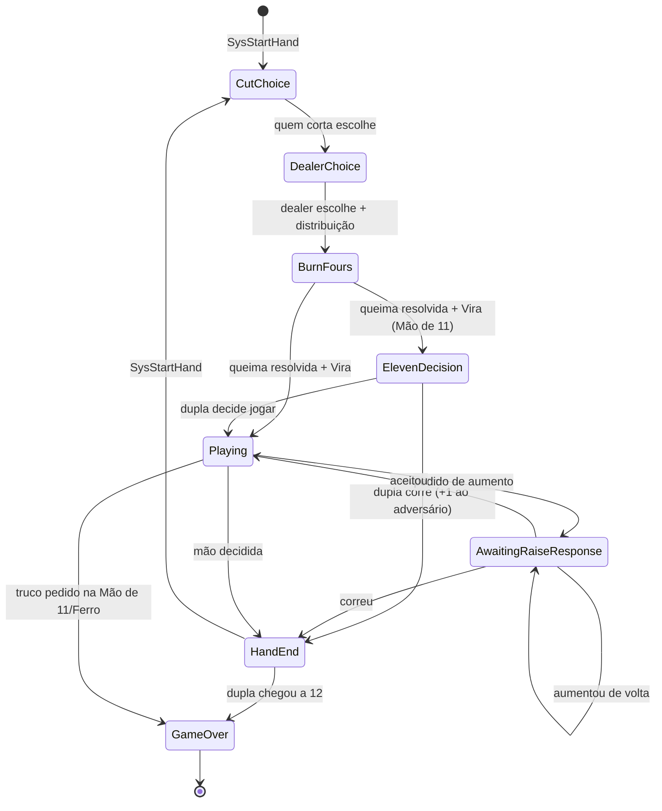
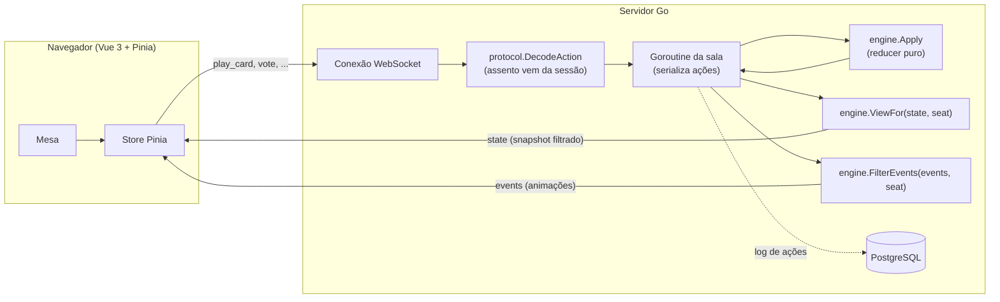

<div align="center">

# 🃏 Truco Multiplayer

**Truco paulista em tempo real para 4 jogadores (2 duplas), com servidor autoritativo em Go e cliente Vue 3.**

[](https://go.dev/)
[](https://vuejs.org/)
[](frontend/src/protocol)
[](#-testes)
[](LICENSE)
[](#-status-e-roadmap)

</div>

---

## Sumário

- [Visão geral](#-visão-geral)
- [Status e roadmap](#-status-e-roadmap)
- [Destaques técnicos](#-destaques-técnicos)
- [Regras do jogo implementadas](#-regras-do-jogo-implementadas)
  - [Baralho e força das cartas](#baralho-e-força-das-cartas)
  - [Vira e manilhas](#vira-e-manilhas)
  - [Fluxo de uma mão](#fluxo-de-uma-mão)
  - [Corte com escolha e distribuição](#corte-com-escolha-e-distribuição)
  - [Queima dos 4](#queima-dos-4)
  - [Rodadas, carta coberta e empates](#rodadas-carta-coberta-e-empates)
  - [Apostas: Truco, 6, 9 e 12](#apostas-truco-6-9-e-12)
  - [Mão de 11 e Mão de Ferro](#mão-de-11-e-mão-de-ferro)
- [Arquitetura](#-arquitetura)
  - [Reducer puro e determinístico](#reducer-puro-e-determinístico)
  - [Anti-cheat: projeção por assento](#anti-cheat-projeção-por-assento)
  - [Eventos e visibilidade](#eventos-e-visibilidade)
  - [Timeouts sem relógio no engine](#timeouts-sem-relógio-no-engine)
- [Protocolo WebSocket](#-protocolo-websocket)
- [Estrutura do repositório](#-estrutura-do-repositório)
- [Como começar](#-como-começar)
- [Usando o engine](#-usando-o-engine)
- [Testes](#-testes)
- [Decisões de design](#-decisões-de-design)
- [Convenções do projeto](#-convenções-do-projeto)
- [Documentação de projeto](#-documentação-de-projeto)
- [Contribuindo](#-contribuindo)
- [Licença](#-licença)

---

## 🎯 Visão geral

O **Truco Multiplayer** é uma implementação completa do Truco paulista (com regras da casa) para quatro jogadores em duas duplas, jogado em tempo real pelo navegador. O projeto nasceu para ser jogado entre colegas de trabalho e também serve de portfólio de engenharia, com foco em:

- **Servidor como única fonte da verdade.** O cliente nunca recebe o estado completo do jogo, só uma *projeção* filtrada para o seu assento. Cartas de adversários, o monte e as cartas queimadas nunca trafegam pela rede.
- **Regras corretas e verificáveis.** O motor de regras é um *reducer* puro, determinístico e sem I/O. Ele é coberto por testes de tabela, testes de propriedade com milhares de partidas aleatórias e um detector automático de vazamento de informação.
- **Contrato tipado ponta a ponta.** Os tipos do protocolo são definidos uma única vez em Go e o TypeScript do frontend é **gerado** a partir deles.

| Camada | Tecnologia |
|---|---|
| Motor de regras | Go puro (somente biblioteca padrão) |
| Servidor | Go `net/http` + [`coder/websocket`](https://github.com/coder/websocket) + `log/slog` *(planejado)* |
| Persistência | PostgreSQL *(planejado)* |
| Frontend | Vue 3 (Composition API, `<script setup>`), TypeScript, Pinia, TailwindCSS *(planejado)* |
| Tipos compartilhados | [`tygo`](https://github.com/gzuidhof/tygo) (Go → TypeScript) |

---

## 🚦 Status e roadmap

O projeto foi decomposto em quatro sub-projetos, cada um com spec, plano e implementação próprios:

| # | Sub-projeto | Escopo | Status |
|---|---|---|---|
| 1 | **Engine de regras + protocolo** | Baralho, força, distribuição, queima, rodadas, apostas, pontuação, projeção anti-cheat, mensagens WebSocket, tipos TS | ✅ **Concluído** |
| 2 | **Contas e persistência** | Cadastro e login (usuário, e-mail e senha), sessão em cookie `HttpOnly`, recuperação de senha, histórico, ranking, replay | 🗓️ Planejado |
| 3 | **Servidor de salas** | Lobby, salas por código, goroutine por sala, WebSocket, timers, reconexão | 🗓️ Planejado |
| 4 | **Frontend** | Mesa em Vue 3, alternância entre baralho francês e espanhol, stores Pinia sincronizadas com o servidor | 🗓️ Planejado |

> Ainda não dá para jogar pelo navegador: hoje o repositório contém o motor de regras completo e testado, o pacote de protocolo e os tipos TypeScript gerados. As próximas etapas constroem servidor, persistência e interface sobre essa base.

### Decisões já tomadas para as próximas etapas

- **Banco:** PostgreSQL (Docker Compose no desenvolvimento).
- **Contas:** usuário, e-mail e senha com hash **argon2id**; login por e-mail **ou** usuário; limite de tentativas no login; cadastro restrito ao(s) domínio(s) de e-mail da empresa (configurável).
- **Sessão:** token opaco aleatório em cookie `HttpOnly`/`Secure`/`SameSite`, com apenas o hash guardado no banco, o que torna o logout revogável. O mesmo cookie autentica o handshake do WebSocket.
- **Recuperação de senha:** e-mail via [Resend](https://resend.com/).
- **Partidas:** a seed e o log de ações de cada partida são persistidos. Como o engine é determinístico, esse log serve ao mesmo tempo para **replay completo**, para **recuperar partidas em andamento** após um restart e para derivar **histórico, estatísticas e ranking**.

---

## ✨ Destaques técnicos

- **Reducer puro:** `Apply(state, action) → (state, events, error)`. Não usa goroutines, I/O nem `time.Now`. Uma ação inválida devolve o estado original intacto.
- **Determinismo total:** o embaralhamento de cada mão vem de `PCG(Seed, HandNumber)`, então a mesma seed com o mesmo log de ações reproduz a partida bit a bit.
- **Anti-cheat por construção:** `ViewFor(state, seat)` é o **único** caminho pelo qual o estado sai do servidor. Cada evento declara sua visibilidade (todos, um assento ou uma dupla).
- **Detector de vazamento independente:** em cada passo de milhares de partidas aleatórias, o teste serializa a visão de cada assento em JSON e verifica que nenhuma carta proibida aparece. A lista de cartas proibidas é calculada sem reutilizar o código de `view.go`.
- **Cobertura:** 98,9% no engine e 100% no protocolo.
- **Entrada hostil tratada:** ações de sistema não são aceitas do cliente; o assento vem da sessão, nunca do payload; campos desconhecidos e payloads vazios são rejeitados.

---

## 📜 Regras do jogo implementadas

### Baralho e força das cartas

O baralho tem **40 cartas** (sem 8, 9 e coringas). Internamente cada carta usa uma representação **neutra**: `Rank` vale `1..7, 10, 11, 12`, e o frontend converte para exibição em dois estilos:

| Valor neutro | Baralho francês | Baralho espanhol |
|---|---|---|
| 1 | A | 1 |
| 10 | J | 10 |
| 11 | Q | 11 |
| 12 | K | 12 |
| 2–7 | 2–7 | 2–7 |

**Força base**, da maior para a menor:

```
3 > 2 > A(1) > K(12) > Q(11) > J(10) > 7 > 6 > 5 > 4
```

Entre cartas comuns, **o naipe não desempata**: duas cartas de mesmo valor de duplas diferentes empatam a rodada (melam).

Cada carta tem um `CardID` estável em `0..39`, calculado como `posiçãoNaEscada × 4 + naipe`.

### Vira e manilhas

Depois da distribuição e da queima, a carta do topo do monte é revelada como **Vira**. As **manilhas** são as quatro cartas do valor imediatamente acima da Vira, de forma cíclica:

| Vira | 4 | 5 | 6 | 7 | J (10) | Q (11) | K (12) | A (1) | 2 | 3 |
|---|---|---|---|---|---|---|---|---|---|---|
| Manilha | 5 | 6 | 7 | J (10) | Q (11) | K (12) | A (1) | 2 | 3 | **4** |

Entre manilhas, o naipe desempata:

```
♣ Paus  >  ♥ Copas  >  ♠ Espadas  >  ♦ Ouros
```

A força final de cada carta é calculada assim:

| Situação | Força |
|---|---|
| Carta coberta (virada para baixo) | `0` |
| Carta comum | `1..10` (posição na escada + 1) |
| Manilha | `11..14` (11 + naipe) |

### Fluxo de uma mão

Cada mão vale inicialmente 1 ponto e segue uma máquina de estados rígida no servidor:



Na **Mão de Ferro** as fases de corte, escolha e queima são puladas: as 12 cartas são distribuídas às cegas e o jogo vai direto para a Vira e a fase `Playing`.

### Corte com escolha e distribuição

Os assentos são numerados `0..3` em sentido horário; as duplas são `{0, 2}` e `{1, 3}`.

1. O **dealer** embaralha. O jogador à **direita** do dealer (`dealer − 1`) corta.
2. **Quem corta** puxa 2 cartas, vê as duas em segredo, fica com uma e **entrega a outra ao parceiro**.
3. O **dealer** faz o mesmo: puxa 2, fica com uma e entrega a outra ao parceiro dele.
4. O restante é distribuído em sentido horário, **começando à esquerda do dealer** e pulando quem já tem 3 cartas, até todos terem 3.
5. O dealer avança um assento a cada nova mão.

### Queima dos 4

Antes da Vira, quem tem algum **4** na mão pode **queimá-lo**: o 4 sai do jogo e é reposto pela carta do topo, no mesmo slot da mão.

- As decisões são **simultâneas**; quem não tem nenhum 4 é marcado como decidido automaticamente, e se ninguém tem 4 a fase é pulada.
- Quando todos decidem, as trocas são resolvidas em ordem horária a partir da esquerda do dealer.
- Se a carta comprada for outro 4, **não há nova queima**.
- **Risco tático:** se a Vira revelada em seguida for um 3, o 4 queimado seria manilha.

### Rodadas, carta coberta e empates

Uma mão tem de 1 a 3 rodadas. Na sua vez, o jogador pode:

- **jogar uma carta aberta**;
- **jogar uma carta coberta** (força 0; serve para blefe ou descarte, e é permitida em qualquer rodada, exceto na Mão de Ferro);
- **pedir aumento da aposta**, antes de jogar a carta.

A 1ª rodada começa à esquerda do dealer. A seguinte começa com quem venceu a anterior; depois de uma rodada empatada, recomeça **quem abriu a rodada empatada**.

A mão é decidida pela **regra paulista de empates**:

| Rodadas | Resultado |
|---|---|
| Uma dupla vence 2 | Essa dupla leva a mão |
| 1ª empata | Leva quem vencer a 2ª; se também empatar, quem vencer a 3ª |
| 1ª vencida por X, 2ª empata | X leva (a 3ª não é jogada) |
| 1ª de X, 2ª de Y, 3ª empata | X leva |
| As três empatam | Ninguém pontua |

### Apostas: Truco, 6, 9 e 12

A escala é estrita: `1 → 3 (Truco) → 6 → 9 → 12`.

- Só se pede aumento **na própria vez e antes de jogar a carta**.
- Uma dupla **não pode aumentar duas vezes seguidas**.
- O pedido coloca o jogo em `AwaitingRaiseResponse`, e **os dois parceiros da dupla desafiada votam**:

| Resposta | Efeito |
|---|---|
| **Aceitar** | A mão passa a valer o novo valor e a vez volta para quem pediu |
| **Correr** | A mão termina e quem pediu ganha o valor **anterior** ao pedido |
| **Aumentar** | A decisão volta para a outra dupla, com o próximo degrau |

- **Divergência entre parceiros:** prevalece o voto mais ousado (`Aumentar > Aceitar > Correr`).
- **Visão de dupla:** durante a votação, os parceiros da dupla que vota veem as cartas um do outro e o voto do parceiro. Os adversários veem apenas *se* cada um já votou.

### Mão de 11 e Mão de Ferro

**Mão de 11** (uma dupla com 11 pontos):

- A mão vale **3 pontos** automaticamente.
- Depois da Vira, a dupla com 11 vê as cartas uma da outra e **vota** entre jogar e correr. Se correr, o adversário ganha 1 ponto.
- **Punição:** se **qualquer** jogador pedir truco nessa mão, a dupla dele **perde a partida imediatamente** (o adversário vai a 12). O engine aceita a ação e aplica a regra; a interface deve pedir confirmação.

**Mão de Ferro** (11 a 11):

- Jogada **no escuro**: o servidor envia as cartas mascaradas (`hidden: true`) **inclusive para o próprio dono**.
- O jogador escolhe o slot às cegas, e a carta só é revelada quando bate na mesa.
- Não há corte com escolha, queima nem carta coberta; pedir truco também é punido.

A partida termina quando uma dupla chega a **12 pontos** (o placar é limitado a 12).

---

## 🏗️ Arquitetura



As linhas tracejadas e os componentes de sala, conexão e banco fazem parte das Specs 2 e 3. O que já existe é o **núcleo**: `engine` e `protocol`.

### Reducer puro e determinístico

```go
func Apply(s GameState, a Action) (GameState, []Event, error)
```

- `Apply` faz uma **cópia profunda** do estado (`Clone`), despacha a ação conforme o tipo e devolve o novo estado e os eventos.
- Em caso de erro, devolve o estado **original** e um `*RuleError` com código estável. Estados intermediários nunca escapam.
- O engine **não tem dependências** fora da biblioteca padrão, não abre goroutines, não faz I/O e não lê relógio.
- O embaralhamento usa `math/rand/v2` com `rand.NewPCG(Seed, HandNumber)`, então não há estado de RNG mutável para serializar.

Isso dá três propriedades importantes:

1. **Testabilidade:** toda regra é testável com funções puras, sem mocks.
2. **Replay:** a seed somada ao log de ações reconstrói qualquer partida.
3. **Concorrência simples:** a sala (uma goroutine) é a única dona do estado e só precisa serializar ações. Não há locks dentro do engine.

### Anti-cheat: projeção por assento

`ViewFor(state, seat) PlayerView` é o único caminho pelo qual o estado sai do servidor.

| Informação | Quem vê |
|---|---|
| Placar, dealer, fase, vez, valor da mão, pedido pendente, resultados das rodadas | Todos |
| Vira e manilha (depois de reveladas) | Todos |
| Cartas abertas na mesa | Todos |
| Carta coberta na mesa | **Só o dono** (os outros veem `covered: true` sem a carta) |
| Quantidade de cartas de cada jogador, tamanho do monte, quantidade queimada | Todos (só as contagens) |
| Própria mão | O dono, **exceto na Mão de Ferro** (`hidden: true`) |
| As 2 cartas do corte | Só quem está escolhendo, durante a sua fase |
| Mão e voto do parceiro | Só a dupla que está votando (aumento ou Mão de 11) |
| Ordem do monte, cartas queimadas, seed do RNG | **Ninguém** |

Os slots da mão (`0..2`) são **estáveis**: jogar ou queimar uma carta não renumera as demais, o que permite escolher às cegas na Mão de Ferro.

### Eventos e visibilidade

Além do snapshot, cada `Apply` produz **eventos** para animação (`card_played`, `round_ended`, `raise_requested`, `vira_revealed`, `hand_ended`, `game_over`…). Cada evento declara a própria visibilidade:

| Visibilidade | Exemplo |
|---|---|
| `all` | `card_played`, `vira_revealed`, `hand_ended` |
| `seat` | `cut_offered` (só quem vai escolher) |
| `team` | `vote_cast` (só a dupla que está votando) |

`FilterEvents(events, seat)` entrega a cada jogador apenas o que ele pode ver. Nenhum evento carrega carta privada: uma carta coberta jogada gera `card_played` **sem** o campo `card`.

### Timeouts sem relógio no engine

O engine expõe `DefaultAction(state, seat)`, a ação aplicada quando o tempo do jogador acaba. Quem mede o tempo é a sala, que injeta `SysTimeout`:

| Fase | Ação padrão |
|---|---|
| Escolha do corte (cortador ou dealer) | Fica com a primeira carta |
| Queima dos 4 | Passa |
| Votação (aumento ou Mão de 11) | Corre |
| Jogada | Joga o menor slot disponível, **coberto** (aberto na Mão de Ferro) |

---

## 🔌 Protocolo WebSocket

Todas as mensagens são JSON com um envelope comum.

**Cliente → servidor**

```json
{ "type": "play_card", "seq": 17, "payload": { "slot": 1, "covered": false } }
```

| `type` | `payload` | Descrição |
|---|---|---|
| `choose_card` | `{ "keep": 0 \| 1 }` | Escolhe uma das 2 cartas do corte |
| `burn` | `{ "slots": [0, 2] }` | Queima os 4 nos slots informados |
| `pass_burn` | — | Não queima nada |
| `play_card` | `{ "slot": 0..2, "covered": bool }` | Joga uma carta, aberta ou coberta |
| `request_raise` | — | Pede truco ou o próximo aumento |
| `vote` | `{ "choice": "accept" \| "run" \| "raise" \| "play" }` | Vota no aumento ou na Mão de 11 |

Regras de segurança aplicadas por `protocol.DecodeAction`:

- o **assento vem da sessão** do servidor e nunca do payload;
- ações de sistema (`sys_start_hand`, `sys_timeout`) **não são aceitas** do cliente;
- campos desconhecidos (por exemplo, um `"seat"` injetado) e payloads vazios, nulos ou sem campos obrigatórios são **rejeitados**.

**Servidor → cliente**

```json
{ "type": "state",  "payload": { "seat": 2, "phase": "playing", "myHand": [ ... ], ... } }
{ "type": "events", "payload": [ { "kind": "card_played", "seat": 1, "card": 27 } ] }
{ "type": "error",  "payload": { "code": "not_your_turn", "message": "...", "seq": 17 } }
```

- `state` é o snapshot **completo e idempotente** da `PlayerView`, enviado a cada mudança. O cliente nunca precisa reconciliar diffs, e a reconexão é trivial.
- `events` serve apenas para animações.
- `error` devolve o `seq` do cliente para correlacionar a resposta.

**Códigos de erro:** `invalid_phase`, `not_your_turn`, `invalid_slot`, `invalid_choice`, `illegal_raise`, `already_voted`, `not_voting_team`, `covered_not_allowed`, `burn_not_four`, `game_over`, `already_decided`, `invalid_seat` e `bad_request` (erro de decodificação).

Os tipos TypeScript correspondentes ficam em [`frontend/src/protocol/engine.ts`](frontend/src/protocol/engine.ts) e [`frontend/src/protocol/messages.ts`](frontend/src/protocol/messages.ts), **gerados** a partir do Go.

---

## 📁 Estrutura do repositório

```
truco-multiplayer/
├── backend/
│   ├── go.mod                         # módulo github.com/caarlosandree/truco-multiplayer/backend
│   ├── tygo.yaml                      # configuração da geração de tipos TS
│   └── internal/
│       ├── engine/                    # motor de regras PURO (somente stdlib)
│       │   ├── card.go                # Suit, Rank, Card, CardID
│       │   ├── deck.go                # baralho de 40 cartas, embaralhamento determinístico
│       │   ├── strength.go            # ManilhaRank, Strength, RoundWinner
│       │   ├── state.go               # GameState, HandState, fases, Clone
│       │   ├── actions.go             # Action e tipos de ação
│       │   ├── events.go              # Event, Visibility, FilterEvents
│       │   ├── errors.go              # RuleError e códigos
│       │   ├── apply.go               # NewGame, Apply, dispatch
│       │   ├── deal.go                # corte com escolha, distribuição, queima, vira
│       │   ├── scoring.go             # jogadas, rodadas, regra de empates, pontuação
│       │   ├── betting.go             # escada de apostas, voto da dupla, Mão de 11
│       │   ├── timeout.go             # DefaultAction (ação padrão por fase)
│       │   ├── view.go                # PlayerView e ViewFor (anti-cheat)
│       │   └── *_test.go              # testes de tabela, propriedade e vazamento
│       └── protocol/                  # envelopes WebSocket e decodificação segura
├── frontend/
│   └── src/protocol/                  # tipos TypeScript GERADOS (não editar à mão)
├── docs/superpowers/
│   ├── specs/                         # especificações de design aprovadas
│   └── plans/                         # planos de implementação
├── Makefile                           # test, test-short, gen-types
└── LICENSE
```

---

## 🚀 Como começar

### Pré-requisitos

- [Go](https://go.dev/dl/) **1.27** ou superior
- `make`
- *(opcional)* Node.js, para validar os tipos TypeScript gerados

### Clonar e testar

```bash
git clone https://github.com/caarlosandree/truco-multiplayer.git
cd truco-multiplayer
make test
```

### Comandos disponíveis

| Comando | O que faz |
|---|---|
| `make test` | Roda toda a suíte (inclui 500 partidas aleatórias, cerca de 7s) |
| `make test-short` | Suíte rápida (100 partidas aleatórias, cerca de 1s) |
| `make gen-types` | Regenera `frontend/src/protocol/*.ts` a partir do Go (tygo v0.2.21) |

Outros comandos úteis:

```bash
cd backend && go test -race -cover ./...
cd backend && go test ./internal/engine/ -run TestRandomGames -v
cd backend && go vet ./...
```

---

## 🧩 Usando o engine

Exemplo de uso direto do reducer, como a sala vai fazer:

```go
package main

import (
	"fmt"

	"github.com/caarlosandree/truco-multiplayer/backend/internal/engine"
)

func main() {
	players := [4]engine.Player{
		{ID: "u1", Name: "Ana"}, {ID: "u2", Name: "Bia"},
		{ID: "u3", Name: "Caio"}, {ID: "u4", Name: "Duda"},
	}
	g := engine.NewGame(players, 42 /* seed */, 0 /* primeiro dealer */)

	g, events, err := engine.Apply(g, engine.Action{Kind: engine.ActSysStartHand})
	if err != nil {
		panic(err)
	}
	fmt.Println(g.Phase, len(events)) // cut_choice 2

	// Quem corta (à direita do dealer) fica com a segunda carta oferecida.
	g, _, err = engine.Apply(g, engine.Action{Kind: engine.ActChooseCard, Seat: g.Cutter(), Keep: 1})
	if err != nil {
		panic(err)
	}

	// Cada jogador recebe apenas a sua projeção do estado.
	for seat := engine.Seat(0); seat < 4; seat++ {
		view := engine.ViewFor(g, seat)
		fmt.Printf("assento %d vê %d carta(s) na mão\n", seat, len(view.MyHand))
	}
}
```

> Os pacotes ficam em `internal/` de propósito: eles serão consumidos pelo servidor deste mesmo módulo e não são uma biblioteca pública com garantia de compatibilidade.

---

## 🧪 Testes

A estratégia é **TDD**: todo comportamento foi escrito primeiro como teste que falha. São **56 funções de teste** (mais subtestes de tabela), com **98,9%** de cobertura no engine e **100%** no protocolo.

| Tipo | O que garante |
|---|---|
| **Tabela de força** | As 10 viras possíveis (incluindo o ciclo 3 → 4), a ordem dos naipes nas manilhas, empates entre comuns e cobertas |
| **Distribuição** | Conservação das 40 cartas, ausência de duplicatas, 3 cartas por jogador, destino correto das cartas do corte, ordem de entrega |
| **Queima** | Reposição no mesmo slot, descarte, ausência de nova queima, resolução simultânea em ordem horária, validação de slots |
| **Apostas** | Escada, bloqueio de aumento consecutivo, voto mais ousado, correr com o valor anterior, contra-aumento, teto em 12, punição |
| **Pontuação** | Todas as combinações da regra paulista de empates |
| **Projeção** | Mãos ocultas, coberta só para o dono, oferta do corte só para quem escolhe, visão de dupla durante a votação |
| **Propriedade** | Centenas de partidas completas com ações legais aleatórias até o fim, verificando invariantes a cada passo (cartas conservadas, placar monotônico) |
| **Vazamento** | Em cada passo dessas partidas, a visão e os eventos de cada assento são serializados em JSON e conferidos contra a lista de cartas proibidas, calculada de forma **independente** de `view.go` |
| **Protocolo** | Decodificação de todas as mensagens, rejeição de ações de sistema, assento injetado, payload vazio e mapeamento dos códigos de erro |

O detector de vazamento foi validado por **mutação**: ao introduzir de propósito vazamentos em `view.go` (revelar cartas cobertas ou mãos ocultas), o teste falha e aponta seed, fase, assento e carta.

---

## 🧠 Decisões de design

| Decisão | Escolha | Motivo |
|---|---|---|
| Núcleo do engine | Reducer puro `Apply(state, action)` | Determinismo, replay e testes sem mocks; a sala só serializa ações |
| Tempo | O engine não lê relógio; a sala injeta `SysTimeout` | Mantém a pureza; timers pertencem à camada de servidor |
| Aleatoriedade | PCG derivado de `(Seed, HandNumber)` | Replay sem precisar serializar estado de RNG |
| Saída de estado | Snapshot completo filtrado por assento | Idempotente, simples de reconectar, impossível vazar por diff |
| Representação de carta | Valor neutro + `CardID` 0..39 | Frontend alterna entre baralho francês e espanhol sem tocar no servidor |
| Ação | Struct plana e serializável | Vai direto para o log de partidas no banco |
| Oferta do corte na view | `[{keep, card}]` em vez de `[]CardID` | O `encoding/json` serializaria `[]uint8` como base64 |
| Tipos TypeScript | Gerados do Go com `tygo` | Uma única fonte da verdade, sem divergência manual |
| HTTP/WS | `net/http` da stdlib + `coder/websocket` | Mínimo de dependências; o roteamento do Go 1.22+ basta |

---

## 📐 Convenções do projeto

- **Código:** identificadores em inglês; comentários, mensagens de erro e documentação em **português do Brasil**.
- **Commits:** [Conventional Commits](https://www.conventionalcommits.org/pt-br/) em português, por exemplo `feat(engine): adiciona projeção anti-cheat por assento`.
- **Branches:** `main` (estável), `staging` (integração) e `feat/*` (funcionalidades).
- **Engine:** proibido importar qualquer coisa fora da biblioteca padrão em `internal/engine`.
- **Tipos gerados:** nunca edite `frontend/src/protocol/*.ts` à mão; rode `make gen-types`.

---

## 📚 Documentação de projeto

O desenho de cada etapa fica versionado no repositório:

- **Spec 1 – Engine de regras e protocolo:** [`docs/superpowers/specs/2026-10-14-truco-engine-protocolo-design.md`](docs/superpowers/specs/2026-10-14-truco-engine-protocolo-design.md)
- **Plano de implementação do engine:** [`docs/superpowers/plans/2026-10-14-truco-engine.md`](docs/superpowers/plans/2026-10-14-truco-engine.md)

---

## 🤝 Contribuindo

1. Abra uma issue descrevendo a regra, o bug ou a melhoria.
2. Crie um branch a partir de `staging` (`feat/minha-mudanca` ou `fix/meu-bug`).
3. Escreva primeiro o teste que falha e depois a implementação.
4. Garanta que `make test` passa e que `go vet ./...` está limpo.
5. Se mudar tipos expostos ao cliente, rode `make gen-types` e inclua os arquivos gerados.
6. Abra um pull request para `staging` com uma descrição clara do que mudou e por quê.

Variações regionais de regra são bem-vindas, desde que venham como configuração explícita e com testes.

---

## 📄 Licença

Distribuído sob a licença **MIT**. Veja [`LICENSE`](LICENSE) para mais detalhes.

<div align="center">

Feito com ♣ ♥ ♠ ♦ por [Carlos André Sabino](https://github.com/caarlosandree)

</div>
